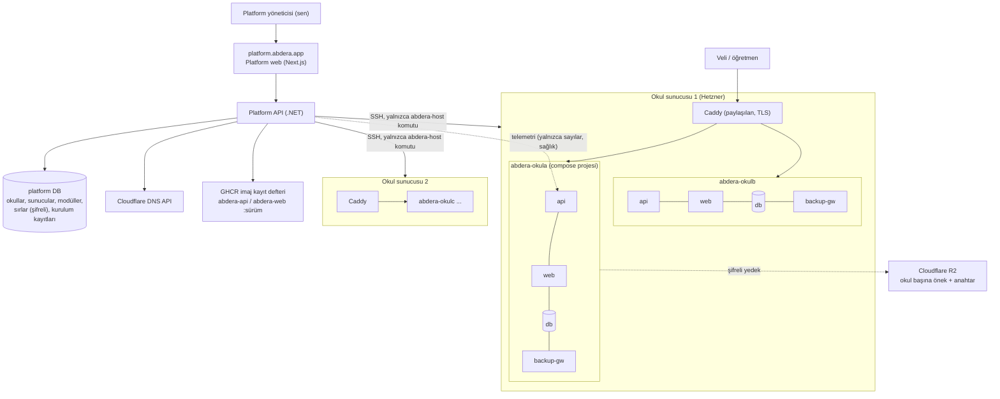
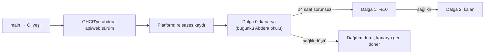

# Abdera Platform — Okul başına bağımsız kurulum mimarisi

> **Durum: YALNIZCA MİMARİ TASLAK — GELİŞTİRİLMEYECEK, `main`'e MERGE EDİLMEYECEK.**
> Bu belge `arch/multi-tenant` branch'inde tutulur. Kodda hiçbir değişiklik yapılmadı.
> `CLAUDE.md`, `docs/10-decisions.md` ve canlı sistem bu belgeden etkilenmez.
> Uygulamaya geçmek, kullanıcının ayrıca ve açıkça onay vermesini gerektirir.
>
> Sürüm 2 · 2026-10-15 · Taban commit: `938e0bc` (sürüm 2026.10.15.3)

## 0. Kullanıcının istediği

> "logosu ayrı olacak, bir dashboard istiyorum yönetmek için, kutucuklar var orta büyüklükte ve en sağda + ile yeni okul yükleyebiliyorsun, yükleme sırasında gerekli veritabanını kuruyor, docker'ı ayarlıyor, bağımsız bir uygulama ayağa kaldırıyor, dns tanımlıyoruz ve kullanmak istediği modüler sistemi next next ile kuruyoruz. banka entegrasyonu, mail hatırlatma, kütüphane ve benzer sisteme yardımcı modüller opsiyonel olacak"

Bundan çıkan gereksinimler:

| # | Gereksinim | Karşılığı |
|---|---|---|
| R1 | Her okulun kendi logosu ve adı | Okul uygulamasında `school_profile` + dinamik marka (§5.1) |
| R2 | Okulları yöneten ayrı bir panel | **Abdera Platform** — ayrı uygulama (§3) |
| R3 | Orta boy kutucuklar, en sağda `+` | Platform ana ekranı (§4.1) |
| R4 | `+` → veritabanı, docker, bağımsız uygulama, DNS | Kurulum durum makinesi + sunucu ajanı (§6) |
| R5 | Modülleri adım adım (next-next) seçme | Kurulum sihirbazı (§4.2) + modül kataloğu (§5.2) |
| R6 | Banka, e-posta hatırlatma, kütüphane vb. opsiyonel | Çekirdek / opsiyonel modül ayrımı ve bağımlılık kuralları (§5.2) |

## 1. Önceki taslaktan (Sürüm 1) ne değişti

Sürüm 1 "tek uygulama + okul başına database" öneriyordu. Bu sürümde kullanıcının isteğiyle **okul başına tamamen bağımsız kurulum** (kendi api, web, db container'ları, kendi alan adı) seçildi. Sürüm 1'de bu seçenek "100 kurulumu elle yönetmek acı verir" diye reddedilmişti; reddin gerekçesi **elle** yönetimdi. Platform kurulum, güncelleme, yedek ve izlemeyi otomatikleştirdiği için gerekçe ortadan kalkıyor.

| | Sürüm 1: tek uygulama, DB/kiracı | Sürüm 2: okul başına bağımsız kurulum |
|---|---|---|
| Okul uygulamasında kod değişikliği | Büyük: kiracı çözümleme, 7 işçinin kiracı döngüsü, singleton → scoped, cookie claim | **Küçük**: marka, modül anahtarları, kurulum ucu. Domain kodu tek kiracılı kalır |
| Veri sızıntısı riski | Kod hatasıyla mümkün | Ayrı process + DB + ağ; kod hatasıyla okul atlamaz. Aynı sunucu ve platform ortak güven sınırıdır, sunucu/platform ele geçirilirse o sunucudaki tüm okullar etkilenir (§16.1) |
| Okula özel sürüm / kademeli güncelleme | Zor (herkes aynı sürüm) | Doğal: her okulun kendi sürümü, kanarya güncelleme |
| WhatsApp webhook'u | Tek uç, numaradan okula yönlendirme gerekir | Her okulun kendi alan adında kendi webhook'u; değişiklik yok |
| Bellek | ~100 okul tek process | Okul başına ~0,5–0,8 GB → 100 okul için 2–3 sunucu |
| Operasyon | Tek deploy | Filo yönetimi gerekir → **Platform** bunu üstlenir |

SQLite sorusu: okul veritabanında **hayır** (gerekçe Sürüm 1 ile aynı: `SKIP LOCKED`, `xmin`, `jsonb`, kısmi index, `pg_dump`). Platform'un kendi küçük veritabanında SQLite teknik olarak yeterli olurdu, ama araç ve yedek tutarlılığı için orada da PostgreSQL önerilir.

## 2. Genel resim



Üç parça var:

1. **Okul uygulaması (bugünkü Abdera)** — tek kiracılı kalır. Marka, modül anahtarları, kurulum ve telemetri uçları eklenir. Her okul bunun bir kopyasını çalıştırır.
2. **Abdera Platform** — yeni, ayrı uygulama. Okulları listeler, kurar, günceller, askıya alır, siler. Okulların kişisel verisine erişmez.
3. **Sunucu ajanı (`abdera-host`)** — her okul sunucusunda duran, yalnızca belirli komutları kabul eden betik. Bugünkü `deploy/hetzner/abdera-deploy` deseninin (`authorized_keys` `command=` + `restrict`) genelleştirilmiş hali.

## 3. Abdera Platform

### 3.1 Yer ve teknoloji
- Repoda yeni klasör: `platform/api` (.NET 10 Minimal API, EF Core, PostgreSQL) ve `platform/web` (Next.js 16, Tailwind, TanStack Query). Okul uygulamasıyla aynı yığın, aynı alışkanlıklar.
- **Ayrı, küçük bir sunucuda** çalışır (okul sunucularında değil): tüm okulların sırlarını tuttuğu için en değerli hedeftir.
- Erişim: `platform.abdera.app`, yalnızca platform yöneticisi. Parola + TOTP (iki adımlı doğrulama) + IP izin listesi veya Cloudflare Access.
- Not: `CLAUDE.md` "Yapılmayacaklar" mikroservis/Kubernetes'i yasaklıyor. Platform bir mikroservis değil, ayrı bir yönetim uygulamasıdır; yine de uygulamaya geçilirse `docs/10-decisions.md`'ye açık karar olarak yazılmalı. Kubernetes kullanılmaz; docker compose + SSH ajanı yeterli.

### 3.2 Veri modeli (platform DB)

| Tablo | Alanlar | Not |
|---|---|---|
| `schools` | id uuid, slug (unique, `^[a-z][a-z0-9-]{2,30}$`), display_name, status, host_id, primary_domain, custom_domain, app_version, modules jsonb, created_at, updated_at, xmin | `status`: Draft → Provisioning → Active / Failed; Active ↔ Suspended; Deleting → Deleted |
| `school_branding` | school_id, logo (bytea, ≤512 KB, PNG/SVG/WebP), primary_color, short_name | Kurulumda okula aktarılır; sonrasında kaynak okulun kendi `school_profile`'ıdır |
| `school_secrets` | school_id, key, ciphertext, created_at | Data Protection ile şifreli: `POSTGRES_PASSWORD`, `Backup:EncryptionKey`, `WhatsApp:*`, `Email:Smtp:*`, banka anahtarları, provisioning/telemetri jetonları |
| `hosts` | id, name, ip, ssh_fingerprint, total_memory_mb, reserved_memory_mb, status, caddy_version | Kapasite: okul başına rezerv bellek (varsayılan 768 MB) |
| `provisioning_runs` | id, school_id, kind (Create/Upgrade/Suspend/Resume/Delete/ModuleChange), status, current_step, started_at, finished_at, error | Her adım idempotent; yarıda kalan çalıştırma kaldığı yerden devam eder |
| `provisioning_steps` | run_id, step, status, attempt, log text, started_at, finished_at | Sihirbazın canlı ilerleme ekranı bunu okur |
| `releases` | version, api_image_digest, web_image_digest, notes, released_at | Yalnızca CI'ın GHCR'ye ittiği sürümler |
| `rollouts` | id, version, wave, status, started_at | Filo güncellemesi (kanarya → dalga) |
| `telemetry_snapshots` | school_id, taken_at, health, student_count, teacher_count, last_backup_at, db_size_mb, app_version | Yalnızca sayılar ve durum; kişi verisi yok |
| `platform_audit_log` | actor, action, school_id, before_json, after_json, at | `JsonSerializer` ile (CLAUDE.md JSON kuralı) |
| `platform_users` | id, email, password_hash, totp_secret (şifreli), security_stamp | Okul kullanıcılarından tamamen ayrı |

### 3.3 Arka plan işleri (platform)
`BackgroundService` + `PeriodicTimer`, okul uygulamasındaki desenle aynı:
- `ProvisioningWorker` — bekleyen `provisioning_runs` kayıtlarını `FOR UPDATE SKIP LOCKED` ile alır ve adımları yürütür (§6).
- `TelemetryPoller` — 5 dakikada bir her okulun `/api/instance/telemetry` ucunu çağırır; ulaşılamayan okul kutucukta kırmızıya döner, e-posta alarmı.
- `RolloutWorker` — sürüm dalgalarını yürütür (§7).
- `CertificateWatcher` — TLS bitiş tarihlerini izler (Caddy yeniler; bu yalnızca güvence).

## 4. Platform arayüzü

### 4.1 Ana ekran — okul kutucukları

```
┌─────────────────────────────────────────────────────────────────────────────────────┐
│  Abdera Platform            Okullar · Sunucular · Sürümler · Denetim     [ara…] (⚙) │
├─────────────────────────────────────────────────────────────────────────────────────┤
│  [Tümü 12] [Aktif 10] [Sorunlu 1] [Kuruluyor 1] [Askıda 0]   Sırala: Ad ▾            │
│                                                                                     │
│  ┌──────────────────┐ ┌──────────────────┐ ┌──────────────────┐ ┌──────────────────┐ │
│  │ [LOGO]   ● Aktif │ │ [LOGO]  ● Sorun  │ │ [LOGO] ◌ Kurulu… │ │                  │ │
│  │ Abdera Sanat     │ │ Do Re Mi Akademi │ │ Nota Müzik       │ │        +         │ │
│  │ abdera.abdera.app│ │ doremi.abdera.app│ │ nota.abdera.app  │ │   Yeni okul      │ │
│  │ 148 öğr · 8 öğt  │ │ 62 öğr · 4 öğt   │ │ Adım 6/11        │ │                  │ │
│  │ v2026.10.15.3    │ │ Yedek: 3 gün önce│ │ ▓▓▓▓▓▓░░░░       │ │                  │ │
│  │ 🏦 ✉ 📚 🎭 📈    │ │ ✉ 📚             │ │                  │ │                  │ │
│  └──────────────────┘ └──────────────────┘ └──────────────────┘ └──────────────────┘ │
└─────────────────────────────────────────────────────────────────────────────────────┘
```

- Kutucuk boyu orta (~260×180 px), ızgara `repeat(auto-fill, minmax(240px, 1fr))`. **`+` kutucuğu her zaman son sırada** (filtrelense bile), kesikli kenarlı.
- Kutucukta: okulun logosu, adı, alan adı, durum rozeti, öğrenci/öğretmen sayısı (telemetriden), sürüm, son yedek yaşı, açık modüllerin simgeleri. Kuruluyorsa ilerleme çubuğu ve adım.
- Durum renkleri: Aktif (yeşil), Sorunlu (kırmızı: sağlık kontrolü başarısız / yedek >36 saat), Kuruluyor (mavi, animasyonlu), Güncelleme bekliyor (sarı), Askıda (gri).
- Kutucuğa tıklama → okul detay ekranı. Sağ üstte `⋯` menüsü: Okulu aç, Güncelle, Askıya al, Yedek al.
- Mobilde 1, tablette 2, masaüstünde 4–5 sütun.

### 4.2 `+` → Yeni okul sihirbazı (next-next)

Her adım taslak olarak platform DB'ye kaydedilir (`schools.status = Draft`); sihirbaz kapatılsa bile kaldığı yerden açılır. "İleri" doğrulamadan geçmeden açılmaz, "Geri" her zaman serbest.

| Adım | Başlık | Alanlar | Doğrulama |
|---|---|---|---|
| 1 | **Okul bilgileri** | Okul adı, kısa ad, logo (sürükle-bırak, önizlemeli, kırpma), ana renk, saat dilimi (varsayılan `Europe/Istanbul`), şehir, iletişim telefonu/e-postası | Logo ≤512 KB, kare önerilir; renk kontrast kontrolü (beyaz metin okunur mu) |
| 2 | **Adres** | Alt alan adı (`<slug>.abdera.app`, okul adından önerilir) **veya** özel alan adı (`panel.okulum.com`) | Slug benzersiz ve ayrılmış listede değil (`platform`, `www`, `api`, `admin`…). Özel alan adında CNAME talimatı gösterilir, doğrulanmadan kuruluma geçilmez |
| 3 | **Yönetici hesabı** | Okul yöneticisinin adı, e-postası | E-posta biçimi. Geçici parola platformda gösterilmez; kurulum sonunda yöneticiye e-postayla gider, ilk girişte değiştirmesi zorunlu |
| 4 | **Modüller** | Çekirdek modüller kilitli işaretli; opsiyonel modüller anahtarlı kartlar (§5.2) | Bağımlılık kuralları canlı uygulanır: "Kârlılık" açılınca "Gelir-gider" otomatik açılır ve bilgi notu çıkar; bağımlısı açıkken kapatma engellenir |
| 5 | **Modül ayarları** | Yalnızca seçilen modüllerin ayarları: WhatsApp (Phone Number ID, WABA ID, erişim jetonu, App Secret), E-posta (SMTP veya platformun ortak gönderici hesabı), Banka (sağlayıcı + anahtarlar), AI (açık/kapalı) | Her entegrasyon için **"Bağlantıyı dene"** düğmesi; başarısız test "İleri"yi engellemez ama özet ekranında uyarı olarak kalır |
| 6 | **Okul kuralları** | Ders türleri ve ilk tarifeler (Birebir/Grup), çoklu kurs ve kardeş indirimi, vade günü, peşin ödeme kademeleri, öğretmen ödeme haftası kapanış günü, grup dersi öğretmen payı, haftalık ders üst sınırı, telafi süreleri | Varsayılanlar bugünkü Abdera değerleri; "Varsayılanları kullan" tek tık |
| 7 | **Sunucu ve kaynaklar** | Sunucu (varsayılan: otomatik — en çok boş kapasitesi olan), yedek saklama süresi | Seçilen sunucuda rezerv bellek yeterli mi |
| 8 | **Özet ve kur** | Tüm seçimlerin özeti, tahmini aylık maliyet, "Kur" düğmesi | Son onay; tıklanınca `provisioning_runs` kaydı açılır |
| 9 | **Kurulum ilerlemesi** | Adım adım canlı liste (§6), her adımın süresi ve logu, hata olursa "Yeniden dene" / "İptal et ve temizle" | Bittiğinde: "Okulu aç" düğmesi, yöneticiye giden e-postanın durumu |

### 4.3 Okul detay ekranı
- Üst: logo, ad, durum, alan adı, sürüm, sunucu.
- Sekmeler:
  - **Genel** — telemetri grafikleri (öğrenci sayısı, DB boyutu), son sağlık kontrolleri, son 10 platform işlemi.
  - **Modüller** — sihirbazdaki modül kartları; değişiklik bir `ModuleChange` çalıştırması başlatır (env güncelle + api/web yeniden başlat, ~30 sn kesinti uyarısı).
  - **Marka** — logo/ad/renk değişikliği (okula itilir).
  - **Entegrasyonlar** — sırların yenilenmesi, "Bağlantıyı dene".
  - **Sürüm** — mevcut sürüm, "Bu sürüme güncelle", geri dönüş.
  - **Yedekler** — son yedekler, "Şimdi yedekle", geri yükleme talimatı.
  - **Tehlikeli bölge** — Askıya al / Devam ettir / Sil (okul adını yazarak onay; silme önce son yedeği alır, 30 gün bekletir).

### 4.4 Diğer platform ekranları
- **Sunucular** — her sunucunun bellek/disk/CPU doluluğu, üzerindeki okullar, "Sunucu ekle" (Hetzner sunucusunu elle açıp IP + SSH anahtarı girme; ajan kurulum betiği gösterilir).
- **Sürümler** — GHCR'deki sürümler, sürüm notları (`frontend/src/data/releases.ts`'den), dalga dalga dağıtım.
- **Denetim** — `platform_audit_log`.

## 5. Okul uygulamasında (bugünkü Abdera) yapılacak değişiklikler

Okul uygulaması tek kiracılı kalır; domain kodu (aidat, takvim, yoklama, `PersonEraser`, kısıtlar) değişmez.

### 5.1 Marka (logo ayrı olacak)

| Değişiklik | Yer | Ayrıntı |
|---|---|---|
| `school_profile` tablosu (tek satır, `BillingSettings` deseni) | yeni `Modules/Ops/Domain/SchoolProfile.cs` + migration | name, short_name, logo bytea, logo_content_type, primary_color, contact_phone, contact_email, updated_at, xmin. Logo DB'de, tıpkı `ScoreFile` gibi; volume yok, yedekle birlikte taşınır |
| Herkese açık uçlar | yeni `Modules/Ops/Features/SchoolProfile.cs` | `GET /api/instance/profile` (ad, renk, logo URL'i), `GET /api/instance/logo` (ETag + uzun önbellek), `PUT /api/instance/profile` (Admin, audit'li) |
| Marka bileşeni | `frontend/src/components/icons.tsx` (`BrandMark`), `app/dashboard/app-header.tsx` | Sabit `abdera-logo.webp` yerine `/api/instance/logo`; yedek: okulun baş harfleri |
| Sayfa başlıkları | `frontend/src/app/layout.tsx` | `metadata` → `generateMetadata` (sunucu tarafında profil okunur): `"%s · <okul kısa adı>"` |
| PWA | `frontend/src/app/manifest.ts`, `icon.png`, `apple-icon.png`, `favicon.ico` | Dinamik manifest + `app/icon.tsx` route'u ile logodan üretilen ikonlar |
| Giriş ve veli portalı | `app/login/page.tsx`, `app/parent/**` | Okul adı ve logosu |
| Diğer metinler | `components/app-loader.tsx`, `components/whats-new.tsx`, `app/gizlilik/page.tsx` | "Abdera" → okul adı; gizlilik metninde veri sorumlusu olarak okulun unvanı |
| E-posta ve WhatsApp | `Modules/Messaging/Features/NotificationMessageBuilder.cs`, e-posta şablonları | Gönderen/imza okul adı. **WhatsApp şablonları her okulun kendi WABA hesabında Meta onayından ayrı geçmek zorunda** — kurulum adımı değil, okul başına operasyon işi |
| Ürün markası | footer | "Abdera ile çalışır" küçük ibaresi (opsiyonel) |

### 5.2 Modül sistemi

**Katalog** (tek kaynak: yeni `Shared/Modules/ModuleCatalog.cs`; platform da aynı listeyi `GET /api/instance/modules/catalog` ile okur, böylece iki uygulama ayrışmaz):

| Anahtar | Ad | Tür | Bağımlılık | Bugünkü kod | Kapalıyken |
|---|---|---|---|---|---|
| `core.people` | Öğrenci, veli, öğretmen | Çekirdek | — | `People` | — |
| `core.scheduling` | Takvim, seri ders, müsaitlik | Çekirdek | people | `Scheduling` | — |
| `core.attendance` | Yoklama, telafi kredisi | Çekirdek | scheduling | `Attendance`, `MakeupCredit` | — |
| `core.billing` | Aidat, tarife, tahsilat | Çekirdek | people | `Billing` (aidat kısmı) | — |
| `core.notifications` | Ekran içi personel bildirimleri | Çekirdek | — | `StaffNotification` | — |
| `core.ops` | Sağlık, yedek | Çekirdek | — | `Ops` | — |
| `groups` | Grup dersleri | Opsiyonel | scheduling, billing | `LessonGroup`, `GroupLessonPay` | Grup ekranı gizli, grup kaydı açılamaz |
| `finance` | Gelir-gider, öğretmen ödemeleri | Opsiyonel | billing | `Expenses`, `TeacherWeeklyPayout`, `TeacherMonthlyGroupPayout` | "Gelir ve gider" gizli |
| `profitability` | Kârlılık ve büyüme fikirleri | Opsiyonel | finance | `Profitability` | Sekme gizli |
| `progress` | Gelişim, ders notu, ödev, karne | Opsiyonel | scheduling | `Progress` | Gelişim gizli; `LessonNoteReminderWorker` durur |
| `whatsapp` | WhatsApp bildirimleri ve RSVP | Opsiyonel | — | `Messaging` (WhatsApp tarafı) | `WhatsApp:Provider=Disabled` (bugün zaten var: `DisabledWhatsAppClient`); Mesaj Merkezi gizli |
| `email` | E-posta hatırlatmaları | Opsiyonel | — | `IEmailSender` kullanan personel bildirimleri, `AttendanceReminderWorker` e-postaları | Yeni `Email:Provider=Disabled`; ekran içi bildirim sürer |
| `banking` | Banka entegrasyonu (sanal IBAN) | Opsiyonel | billing | `Banking` | Banka ekranı gizli, `Banking:Provider=Manual`. Gerçek sağlayıcı seçilene kadar sihirbazda "yakında" |
| `library` | Kütüphane ve nota PDF'leri | Opsiyonel | — | `Library` | Kütüphane gizli |
| `show` | Yıl sonu gösterisi | Opsiyonel | people | `Show` | Gizli |
| `parent-portal` | Veli portalı | Opsiyonel | people, billing | `GuardianPortal*`, `app/parent` | `/parent` kapalı, veli girişleri ekranı gizli |
| `ai` | AI yorumları | Opsiyonel | progress **veya** profitability | `IProgressSummaryGenerator`, `IProfitCommentaryGenerator` | Bugünkü `Disabled*Generator` |

**Nasıl uygulanır — her okulda şema aynı kalır:**

1. **Şema hep tam.** Tüm migration'lar her okulda koşar; kapalı modülün tabloları boş durur. Bir modülü sonradan açmak = anahtar değiştirmek, migration yok. Kapatmak veriyi silmez, gizler. `PersonEraser` hiç değişmez (tabloları her zaman var).
2. **Etkin liste ortam değişkeninde:** `Modules__Enabled=groups,finance,library,...`. Her okul ayrı process olduğu için bu gerçek bir ortam değişkenidir.
3. **Uç noktalar:** modül uçları her zaman map edilir, ama grup bazında bir endpoint filtresi (`.RequireModule("library")`) kapalı modülde `404` döner. Filtre konfigürasyonu istek anında okur → `CLAUDE.md`'deki "`Build()`'den önce eager okuma" kuralını bozmaz, `WebApplicationFactory` testleri modülleri açıp kapatabilir.
4. **Arka plan işleri:** her işçi tur başında `ModuleCatalog.IsEnabled(...)` kontrol eder; kapalıysa turu atlar (heartbeat "devre dışı" yazar ki `SystemHealthMonitor` alarm vermesin).
5. **Modüller arası çağrılar** — kapalı modüle dokunan yerler açıkça korunmalı:
   - `People/Features/GuardianPortalData.cs` → Banking (IBAN) ve Progress verisini koşullu ekler.
   - `Billing/Features/SendPaymentReminder.cs`, `Attendance/Features/Rsvp.cs` → `whatsapp` kapalıysa düğme gizli, uç `409` ile açıklama döner.
   - `Scheduling/Features/LessonChangeNotice.cs` → e-posta kısmı `email` modülüne bağlı; ekran içi bildirim (çekirdek) her zaman.
   - `Profitability` → `progress` kapalıysa gelişim sinyalleri olmadan çalışır.
   - `Dashboard/Features/Dashboard.cs` → kapalı modül kartlarını üretmez.
6. **Ön yüz:** `GET /api/instance/config` → `{ modules, profile, version }`. `app-header.tsx`'teki `CORE_LINKS`/`ADMIN_LINKS` her öğeye `module` alanı eklenerek süzülür; kapalı modül sayfasına doğrudan gidilirse "Bu modül bu okulda açık değil" ekranı. Mobil alt menü de aynı listeden.
7. **`ProductionSecretsGuard`:** yalnızca açık modüllerin sırlarını zorunlu tutar (WhatsApp kapalıyken `WhatsApp:AppSecret` istemez).
8. **Testler:** mevcut paket "tüm modüller açık" varsayılanıyla aynen geçer. Her opsiyonel modül için bir "kapalıyken 404 / işçi turu atlar" testi.

### 5.3 Okul kuralları ayara taşınır
Bugün koda sabit yazılı ve sihirbazın 6. adımında sorulacak değerler. Her biri için "hesabın tek yeri" (`CLAUDE.md`) korunur; yalnızca sabit, yeni tek satırlık `school_policy` tablosundan okunur (`BillingSettings` deseni, audit'li, okul ekranındaki Ayarlar'dan da düzenlenir):

| Sabit | Bugünkü yer | Varsayılan |
|---|---|---|
| Grup dersi öğretmen payı | `Modules/Billing/Domain/GroupLessonPay.cs` `SharePercent` | %40 |
| Ödeme haftası kapanışı | `TeacherPayWeek` | Pazartesi → Cumartesi |
| Haftalık ders üst sınırı | `Modules/Scheduling/Domain/StudentWeeklyLessonPolicy.cs` `MaximumLessons` | 4 |
| Telafi kredisi iptal eşiği | `MakeupCredit` | 24 saat |
| Mazeretli telafi süresi | `ExcusedMakeupCredit` | 21 gün |
| Okul günü saatleri | `frontend/src/lib/scheduling.ts` `SCHOOL_DAY_START/END` | 09:00–21:00 |
| Çoklu kurs / kardeş indirimi, vade günü | `BillingSettings` (zaten tabloda) | %5 / %5 / 1 |
| Saat dilimi | `SCHOOL_TIMEZONE` (zaten env) | Europe/Istanbul |

Not: oran değişikliği geçmiş satırları etkilemez — `Receivable` ve ödeme satırları hesabı zaten donduruyor.

### 5.4 Kurulum ve telemetri uçları (yalnızca platform çağırır)

| Uç | Koruma | İş |
|---|---|---|
| `POST /api/instance/provision` | `Provisioning__Token` (env, tek kullanımlık; başarıdan sonra kalıcı olarak kapanır, `audit_log`'a yazılır) | İlk admin (`AdminBootstrapper` mantığı, geçici parola + "ilk girişte değiştir"), `school_profile`, `school_policy`, ilk tarifeler. İdempotent: aynı istek iki kez gelirse ikinci sefer değişiklik yapmaz |
| `GET /api/instance/telemetry` | `Telemetry__Token` (Bearer) | Yalnızca: sürüm, sağlık, öğrenci/öğretmen/aktif kayıt sayısı, son yedek zamanı, DB boyutu, bekleyen bildirim sayısı. **Ad, telefon, tutar yok** (KVKK: platform veri işleyen değil, yalnızca operatör) |
| `POST /api/instance/backup-now` | `Telemetry__Token` | `BackupService`'i tetikler |

Rate limit: mevcut `webhooks` politikası. İki jeton da platformda şifreli saklanır, okulda env'de.

### 5.5 İmaj ve yapılandırma
- **İmajlar sunucuda derlenmez.** Bugün `abdera-deploy` `docker compose up --build` yapıyor (decision P3: "GHCR'ye taşımak ayrı iş"). 100 okulda her sunucuda derleme imkânsız → CI `ghcr.io/<org>/abdera-api:<sürüm>` ve `abdera-web:<sürüm>` imajlarını iter, okullar etikete göre çeker.
- **Ön yüz tek imaj olmalı.** `NEXT_PUBLIC_API_BASE_URL` derleme anında gömülüyor (`frontend/src/lib/api.ts`). Caddy api ve web'i aynı origin'de sunduğu için göreli `/api` kullanılır; okul başına derleme gerekmez. `NEXT_PUBLIC_DEMO_ENABLED` de çalışma zamanı ayarına (`/api/instance/config`) taşınır.
- `docker-compose.yml` → yeni `deploy/instance/compose.yml` şablonu: `build:` yerine `image:`, port publish yok (Caddy ortak ağdan erişir), `container_name` yok (proje adı `abdera-<slug>` önek verir), bellek sınırları (`mem_limit`: api 384 MB, web 256 MB, db 256 MB + `shared_buffers=64MB`, `max_connections=40`).
- Bugünkü `Maximum Pool Size=150` / `max_connections=250` tek büyük okul içindi (`LOADTEST.md`); okul başına 20–30 yeterli.
- `Email` ve sistem alarmları: okulun `SystemHealthMonitor` alarmları okula değil **platforma** gider (`Alerts__WebhookUrl`); platform tek yerden haber verir.

## 6. Kurulum akışı (`+` → çalışan okul)

`ProvisioningWorker`'ın yürüttüğü durum makinesi. Her adım **idempotent** (tekrar çalıştırılınca zarar vermez) ve kendi geri alma adımına sahip.

| # | Adım | Ne yapar | Geri alma |
|---|---|---|---|
| 1 | Ayır | Slug'ı kilitle, `schools.status = Provisioning` | Slug'ı bırak |
| 2 | Sunucu seç | Rezerv bellek yeterli sunucuyu seç, `hosts.reserved_memory_mb` artır (`xmin` ile, iki kurulum aynı son yeri alamaz) | Rezervi geri ver |
| 3 | Sırları üret | `POSTGRES_PASSWORD`, `Backup:EncryptionKey` (32 bayt), `WhatsApp:PayloadSigningKey`, provisioning/telemetri jetonları, Data Protection için boş dizin; sihirbazdan gelen entegrasyon sırlarıyla birlikte şifreli sakla | Sırları sil |
| 4 | DNS | Cloudflare API: `<slug>.abdera.app` → sunucu IP'si (A, proxy kapalı veya açık — §8). Özel alan adında CNAME'in doğru hedefi gösterdiğini doğrula | Kaydı sil |
| 5 | Dosyaları yaz | `abdera-host create <slug>`: `/srv/abdera/<slug>/` altında `compose.yml` (şablon) + `.env` (stdin'den, diske 0600) | Dizini sil |
| 6 | İmajları çek | `abdera-host pull <slug> <sürüm>` | — |
| 7 | Başlat | `abdera-host up <slug>`: db → healthcheck → api (açılışta `DatabaseMigrator` tüm migration'ları uygular) → web → backup-gw | `abdera-host down <slug> --volumes` |
| 8 | Sağlık | `/health` (ajan üzerinden, iç ağdan) 3 dk içinde `Healthy` | — |
| 9 | Okulu hazırla | `POST /api/instance/provision` (iç ağdan): admin, profil, logo, kurallar, tarifeler | Okul DB'si zaten 7'de siliniyor |
| 10 | Yayına al | Sunucudaki paylaşılan Caddy'ye site bloğu ekle (`abdera-host route add <slug> <domain>`), Caddy yeniden yükle, TLS sertifikası alınana kadar bekle | Site bloğunu kaldır |
| 11 | Duman testi | Dışarıdan `https://<domain>/health` 200, `/login` 200, giriş ekranında okul adı görünüyor | — |
| 12 | Bitir | İlk yedek tetiklenir, yöneticiye hoş geldin e-postası (adres + geçici parola + ilk giriş talimatı), `status = Active` | — |

- Hata olursa çalıştırma `Failed` olur, kutucuk kırmızı, ekranda hangi adımda ve neden. "Yeniden dene" kaldığı adımdan devam eder; "İptal et ve temizle" geri alma adımlarını tersten çalıştırır.
- Tahmini süre: imajlar sunucuda önbellekteyse 2–4 dk; TLS ve DNS yayılması en uzun kısım.

### 6.1 Sunucu ajanı `abdera-host`
- Yer: `deploy/host/abdera-host` (bugünkü `deploy/hetzner/abdera-deploy`'un yanına). Platform'un SSH anahtarı `authorized_keys`'te `command="/usr/local/bin/abdera-host",restrict` ile bağlı; başka komut çalıştıramaz.
- Komutlar: `create`, `pull`, `up`, `down`, `upgrade`, `rollback`, `suspend`, `resume`, `backup-now`, `route add|remove`, `status`, `destroy`, `host-info`.
- Girdi doğrulama: slug `^[a-z][a-z0-9-]{2,30}$`, sürüm `^\d{4}\.\d{2}\.\d{2}\.\d+$`, domain biçimi; `flock` ile okul başına kilit (aynı okulda iki işlem aynı anda koşmaz). Paylaşılan Caddy yapılandırmasına dokunan komutlar (`route add|remove`, `suspend`, `resume`) ayrıca **sunucu düzeyinde** kilit alır (§16.2).
- `upgrade`: bugünkü `abdera-deploy` mantığı okul başına — önce `pg_dump` (alınamazsa durur), yeni etiket, `/health` bekle, olmazsa önceki etikete dön.
- Ajan okul veritabanının içeriğini okumaz; yalnızca container yaşam döngüsü ve döküm dosyası.

### 6.2 Sunucu yerleşimi
```
/srv/abdera/
  caddy/Caddyfile              # site blokları ajan tarafından yönetilir (import sites/*.caddy)
  caddy/sites/<slug>.caddy
  <slug>/compose.yml
  <slug>/.env                  # 0600, yalnızca root
  <slug>/predeploy/*.sql.gz    # son 5 güncelleme öncesi döküm
```
- Ağ: her okulun kendi `<slug>-edge` ağı var. Bu ağda o okulun `api`/`web` servisleri ve Caddy bulunur, Caddy bütün okul ağlarına bağlıdır. Okulların `db`'si yalnızca kendi iç ağında. Böylece okullar birbirinin DB, API ve web servislerine ağ düzeyinde ulaşamaz (§16.1). Ortak bir `abdera-edge` ağı **kullanılmaz**.
- Sunucu başına tek Caddy (okul başına değil).

## 7. Güncelleme (filo)



- Bugünkü `.github/workflows/deploy.yml` (tek sunucuya SSH) yerini "imaj it + platforma bildir"e bırakır. `abdera-deploy` skill'i ve `run-abdera` gece turu kanarya okulunu günceller; diğer okullar platformdaki dağıtımla.
- Migration'lar ileri uyumlu yazılmalı (geri dönüşte şema geri gelmiyor — bugünkü kural, decision P3). Okul sayısı arttıkça bu kural daha kritik: kolon silme iki sürüme yayılır.
- Okul bazında "sürümü sabitle" seçeneği (sorunlu bir okul dağıtımdan muaf tutulur).

## 8. DNS ve TLS

- Bugün DNS İHS DNS Zone'da (decision P1) — API ile otomasyona uygun değil. **`abdera.app` (veya seçilecek ürün alan adı) Cloudflare'e taşınır**; R2 zaten Cloudflare'de.
- Kayıt: okul başına `<slug>` A kaydı (wildcard `*` yerine tek tek — silinen okulun adresi boşa düşer, sahte alt alan adı çözülmez).
- TLS: Caddy her site için Let's Encrypt HTTP-01 ile kendisi alır. Alternatif: wildcard sertifika + DNS-01 (Caddy Cloudflare eklentisi gerekir → özel Caddy imajı). Başlangıçta HTTP-01 yeterli; Let's Encrypt sınırı alan adı başına haftada 50 sertifika, 100 okulun ilk kurulumu birkaç haftaya yayılır veya wildcard'a geçilir.
- Özel alan adı: okul kendi DNS'inde CNAME → `<slug>.abdera.app`; platform doğrulayıp Caddy'ye ikinci ad olarak ekler.

## 9. Yedek, askıya alma, silme

- Her okulun kendi `backup-gw` (rclone sftp → R2) servisi, R2'de `abdera-backups/<slug>/` öneki ve **okul başına ayrı şifreleme anahtarı** — bir anahtarın sızması tek okulu etkiler.
- Platform kutucukta son yedek yaşını gösterir; 36 saati geçerse kırmızı.
- Geri yükleme: `abdera-host restore <slug> <yedek>` (yeni okul kurulumunun 7. adımı + `pg_restore`) — önce test okuluna geri yükleme tatbikatı (`docs/16-backup-restore.md` genişletilir). Prova/test geri yüklemesi dış bağlantılar **kapalı** başlar (§16.7).
- Askıya alma: önce son bir yedek alınır ve saklama kuralı dışındaki `abdera-backups/<slug>/suspended/` önekine kopyalanır. Sonra api/web durur, Caddy "Hesap askıda — okul yönetimiyle iletişime geçin" sayfası gösterir; DB volume'ü durur. Yedek üreticisi API içinde olduğu için askıda yeni yedek **alınmaz**. Alınmasına gerek de yoktur, çünkü yazan kimse yok (§16.3).
- Silme: son yedek → 30 gün bekleme (geri alınabilir; süreyi platform değil **ajan** zorlar, §16.9) → container + volume + DNS + Caddy bloğu + sırlar silinir. R2'deki yedekler mevcut kilit/lifecycle kuralıyla (60/65 gün) kendiliğinden düşer. `platform_audit_log` kalır.

## 10. Kapasite ve maliyet (tahmin — yük testiyle doğrulanmalı)

| Bileşen | Boşta | Yoğun |
|---|---|---|
| api (.NET 10) | ~180 MB | ~350 MB |
| web (Next.js standalone) | ~120 MB | ~200 MB |
| db (Postgres 16, küçük ayar) | ~80 MB | ~250 MB |
| backup-gw | ~20 MB | ~60 MB (yedek sırasında) |
| **Okul başına** | **~0,4 GB** | **~0,8 GB** |

- Planlama değeri okul başına 768 MB rezerv. 64 GB'lık bir sunucuda (~%20 pay bırakarak) ~65 okul. **100 okul ≈ 2 okul sunucusu + 1 küçük platform sunucusu.** Bu yerleşimde bir sunucu çökerse kalan sunucu 100 okulu **taşıyamaz** (2 × 65 = 130 normal kapasite, tek sunucuda 65). Bu kabul edildi: sunucu çökerse platform otomatik bir şey yapmaz, okullar sunucu geri gelene kadar kapalı kalır (§16.6).
- Bellek baskısı artarsa ilk iyileştirme: sunucu başına paylaşılan tek Postgres (okul başına ayrı database + ayrı kullanıcı) — okulun "bağımsızlığı" uygulama düzeyinde sürer, ~100 Postgres process'i 2'ye iner. Başlangıçta gerekmez.
- `.NET` için `DOTNET_GCHeapHardLimit` ve `DOTNET_gcServer=0` (workstation GC) okul başına belleği belirgin düşürür.
- Doğrulama: `loadtest/` senaryosu tek okul profiliyle, 30 okul aynı sunucuda eşzamanlı.

## 11. Güvenlik ve KVKK

- Okullar arası izolasyon: ayrı container, ayrı DB, okul başına ayrı ağ, ayrı sırlar, ayrı yedek anahtarı. Bu, kod hatasına ve ele geçirilmiş **tek bir okul uygulamasına** karşı korur. Sunucu (Docker = root) ya da platform ele geçirilirse o sunucudaki/filodaki tüm okullar etkilenir (§16.1, §16.9).
- Platform okulların kişisel verisini okumaz; telemetri yalnızca sayı. Destek için okula giriş gerekiyorsa okul yöneticisinin açtığı geçici destek hesabıyla, okulun `audit_log`'una yazılarak.
- Platform: ayrı sunucu, TOTP, IP kısıtı, sırlar Data Protection ile şifreli ve anahtar dizini yedekli (kaybolursa tüm okulların sırları okunamaz → anahtar ayrıca parola yöneticisinde).
- Ajan: tek komut, girdi doğrulamalı, okul başına kilitli.
- Sözleşme: okul veri sorumlusu, Abdera veri işleyen (DPA), VERBİS; aydınlatma metni okul adıyla (`app/gizlilik`).
- Abonelik ödemesi için online ödeme/checkout `CLAUDE.md` yasak listesinde — faturalandırma ilk aşamada elle (platformda yalnızca "ödendi / gecikti" işareti).

## 12. Yapılacak değişikliklerin tam listesi

### A. Okul uygulaması (`backend/`, `frontend/`)
1. `school_profile` tablosu + migration + `GET/PUT /api/instance/profile`, `GET /api/instance/logo` (§5.1).
2. `school_policy` tablosu + migration; `GroupLessonPay`, `TeacherPayWeek`, `StudentWeeklyLessonPolicy`, `MakeupCredit`, `ExcusedMakeupCredit` sabitleri oradan okunur; Ayarlar ekranında düzenleme (§5.3).
3. `Shared/Modules/ModuleCatalog.cs` + `RequireModule` endpoint filtresi + işçilerde modül kontrolü + `GET /api/instance/config` (§5.2).
4. Modüller arası çağrıların korunması: `GuardianPortalData`, `SendPaymentReminder`, `Rsvp`, `LessonChangeNotice`, `Dashboard`, `ProfitabilitySnapshotBuilder` (§5.2 madde 5).
5. `Email:Provider=Disabled` modu; `ProductionSecretsGuard`'ın modüle göre sır istemesi.
6. `POST /api/instance/provision`, `GET /api/instance/telemetry`, `POST /api/instance/backup-now` (§5.4).
7. Alarmların platforma gitmesi (`Alerts__WebhookUrl`).
8. Ön yüz: dinamik `BrandMark`, `generateMetadata`, dinamik manifest/ikonlar, giriş ve veli portalında marka, gizlilik metni (§5.1).
9. Ön yüz: menünün modüle göre süzülmesi, kapalı modül sayfası, `/parent`'ın `parent-portal` modülüne bağlanması.
10. Ön yüz: göreli `/api`, `NEXT_PUBLIC_*` değişkenlerinin çalışma zamanı ayarına taşınması (tek imaj).
11. Okul günü saatlerinin (`SCHOOL_DAY_START/END`) `school_policy`'den gelmesi.
12. Testler: modül kapalıyken 404/işçi atlar, provision ucunun tek kullanımlığı, telemetride kişi verisi olmadığı, marka uçları.

### B. Dağıtım (`deploy/`, `.github/`)
13. CI: `abdera-api` ve `abdera-web` imajlarını sürüm etiketiyle GHCR'ye itme.
14. `deploy/instance/compose.yml` şablonu + `.env` şablonu (bellek sınırları, küçük havuz).
15. `deploy/host/abdera-host` ajanı + sunucu kurulum betiği (Docker, okul başına `<slug>-edge` ağı, paylaşılan Caddy, sunucu düzeyinde Caddy kilidi, `authorized_keys` kısıtı).
16. Paylaşılan Caddy yapılandırması (`import sites/*.caddy`, askı sayfası).
17. `deploy.yml` ve `abdera-deploy` → kanarya okulu güncellemesi; mevcut okulun `/opt/abdera`'dan `/srv/abdera/abdera/` düzenine taşınması (bir kerelik, bakım penceresinde, döküm + geri yükleme ile).
18. DNS'in Cloudflare'e taşınması.

### C. Platform (yeni: `platform/`)
19. `platform/api`: kimlik (parola + TOTP), `schools`/`hosts`/`secrets`/`provisioning_*`/`releases`/`rollouts`/`telemetry_snapshots`/`platform_audit_log` tabloları ve migration'ları.
20. `ProvisioningWorker` (§6 durum makinesi), `TelemetryPoller`, `RolloutWorker`, `CertificateWatcher`.
21. İstemciler: Cloudflare DNS, SSH ajanı (komut başına tek çağrı, zaman aşımı, çıktı loglama), GHCR sürüm listesi.
22. `platform/web`: kutucuk ana ekranı, 9 adımlı sihirbaz, okul detay sekmeleri, sunucular, sürümler, denetim.
23. Platform testleri: durum makinesinin her adımda kesilip yeniden başlatılması, geri alma, iki eşzamanlı kurulumun aynı son kapasiteyi alamaması, ajan girdi doğrulaması.

### D. Dokümantasyon ve süreç
24. `docs/10-decisions.md`: platform kararı, GHCR, Cloudflare DNS, modül kataloğu, `school_policy`.
25. `CLAUDE.md`: modül anahtarı kuralı ("yeni bir özellik hangi modüle ait, kapalıyken ne olur"), `school_policy` kuralı ("okula özel sabit koda yazılmaz").
26. `docs/19-hetzner-runbook.md` → çok sunuculu runbook; `docs/16-backup-restore.md` → okul başına geri yükleme.
27. `abdera-deploy` / `run-abdera` skill'lerinin kanarya düzenine uyarlanması.

## 13. Fazlar (her biri ayrı onay gerektirir)

| Faz | Kapsam | Çıktı | Canlı okula etkisi |
|---|---|---|---|
| F1 | A1, A3–A5, A8–A10, B13 | Bugünkü okul kendi logosu/adıyla, tüm modüller açık, GHCR imajıyla çalışıyor | Görsel değişiklik yok |
| F2 | B14–B16, A6, §16.1–16.3, 16.7, 16.9 | İkinci okul **elle** (`abdera-host` komutlarıyla) kurulabiliyor; izolasyon, Caddy kilidi, askı yedeği, prova geri yüklemesi ve iki aşamalı silme kanıtlanmış | Yok |
| F3 | C19–C21, B18 | Platform API kurulumu uçtan uca yürütebiliyor (arayüzsüz) | Yok |
| F4 | C22–C23 | Kutucuklar + sihirbaz | Yok |
| F5 | A2, A11, A7, B17, C20 (rollout) | Okul kuralları ayarda, filo güncellemesi, mevcut okul platforma taşındı | Bakım penceresi |
| F6 | D24–D27, pilot 3–5 okul | Satışa hazır | — |

## 14. Doğrulama

- Kurulum: boş bir test sunucusunda sihirbazdan okul kur → 12 adım yeşil → `https://<slug>.abdera.app` açılıyor, logo ve ad doğru, admin e-postası geldi, ilk girişte parola değişimi zorunlu.
- Kesinti dayanıklılığı: kurulumu 7. adımda platform process'ini öldürerek kes → yeniden başlayınca kaldığı yerden tamamlanıyor. "İptal et ve temizle" sonrası sunucuda, DNS'te, Caddy'de iz kalmıyor.
- İzolasyon: okul A'nın oturum çereziyle okul B'ye istek → 401; okul A'nın container'ından okul B'nin DB'sine bağlantı → ağ düzeyinde ulaşılamıyor.
- Modüller: kütüphane kapalı okulda menüde yok, `/api/library/*` 404, açınca veri kaybı olmadan geri geliyor.
- Güncelleme: kanaryada bilerek bozuk sürüm → sağlık düşüyor, otomatik geri dönüş, dalga 1 başlamıyor.
- Yedek: rastgele bir okulun dünkü yedeğini test okuluna geri yükle, öğrenci sayısı telemetriyle tutuyor.
- Yük: 30 okul aynı sunucuda, her birinde mevcut `loadtest/` profili; bellek rezervi aşılmıyor, p95 < 500 ms.

## 15. Uygulama ilerlemesi (yalnızca bu branch'te)

| Tarih | Faz | Yapılan | Doğrulama |
|---|---|---|---|
| 2026-10-15 | F1 (A1, A3) | Modül kataloğu (`Shared/Modules/ModuleCatalog.cs`), `Modules__Enabled` ayarı (boşsa hepsi açık), kimlik doğrulamadan önce 404 dönen modül kapısı. Kapıya bağlanan modüller: kütüphane, gösteri, banka, kârlılık, gelişim (ders notu çekirdekte kalır). Okul profili: `school_profile` tablosu + `GET /api/instance/config`, `GET/PUT/DELETE /api/instance/logo`, `PUT /api/instance/profile` (yalnızca yönetici, audit'li). | 19 yeni test; tüm paket 713/714 (düşen test `main`'de de düşüyor, saate bağlı); migration ileri/geri geçici Postgres'te denendi |
| 2026-10-15 | F1 (A3, A4 kısmi, A8 kısmi, A9) | `Modules__Enabled=none` yalnızca çekirdeği açar (boş değer eski kurulum = hepsi açık; ChatGPT incelemesi madde 5). Banka kapalıyken veli portalı sanal IBAN göstermez. Ön yüz: `lib/instance.ts` (`useInstanceConfig`, yüklenemezse hepsi açık + "Abdera"), menü modüle göre süzülür, kapalı modül sayfasına doğrudan gidilirse "bu okulda açık değil" ekranı, Gelir-gider'de Kârlılık sekmesi modüle bağlı, Hata bildir sayfa listesi süzülür, banka uyarı sorgusu modül kapalıyken çalışmaz. Marka: `SchoolBrandMark` menüde ve girişte okulun kısa adı/alt satırı/logosunu gösterir; logosu olmayan başka okul Abdera logosu yerine baş harfleri taşır. | 3 yeni test (tüm paket 716/717, düşen test yine saate bağlı `SwapLessonsFlowTests`); ayrı yerel DB üzerinde `Modules__Enabled=progress` ile tarayıcıda: Kütüphane/Gösteri/Banka menüden düştü, `/dashboard/banking` kapalı ekranı gösterdi, Kârlılık sekmesi yok, okul adı değişince menü markası değişti |
| 2026-10-15 | F1 (A3, A8 kısmi, A9 kısmi) | **Veli portalı modülü** (`parent-portal`, bağımlılık: people + billing): veli girişi/OTP, `/api/guardian/me/**`, veli gelişim/karne/çalışma günlüğü uçları ve yöneticinin veli giriş bilgisi uçları (`/api/guardians/logins`, `reset-password`, `reveal-password`) modül kapalıyken 404. Velinin kendisi (iletişim, öğrenci bağı, WhatsApp) çekirdekte kalır. Ön yüz: girişte "Veliyim" seçeneği, "Veli girişleri" menüsü ve öğrenci detayındaki "Giriş şifresini sıfırla" gizlenir; `/parent` yapılandırma gelene kadar bekler, kapalıysa açıklama gösterir; **yeni öğrenci kaydı kapalı modülde veli şifresi üretmeye çalışmaz** (yoksa kayıt 404 ile yarıda kalırdı). **Okul bilgileri paneli** (Ayarlar, yalnızca yönetici): tam ad, kısa ad, logo yükle/değiştir/kaldır, canlı önizleme. Yükleme ekranı ve veli girişi okul logosunu/markasını kullanır. | 1 yeni test (tüm paket 717/718, düşen test yine saate bağlı `SwapLessonsFlowTests`); ayrı yerel DB'de `Modules__Enabled=progress` ile tarayıcıda: "Veliyim" yok, `/parent` açıklama ekranı ve hiç `/api/guardian` isteği yok, Ayarlar'dan ad ve PNG logo değişikliği menüye ve önizlemeye yansıdı |

**Sıradaki adımlar (F1 devamı):** A8'in kalanı — `generateMetadata` ile sayfa başlığı, dinamik manifest/ikonlar (sunucu tarafında API'ye erişim gerektirir), gizlilik metninde okul unvanı, `primaryColor`'un temaya uygulanması (alan saklanıyor, arayüzde düzenlenmiyor). A9'un kalanı — öğrenci detayındaki gelişim/karne bağlantıları gibi menü dışı giriş noktalarının `progress` modülüne bağlanması. A10 — `NEXT_PUBLIC_DEMO_ENABLED`'ın çalışma zamanına taşınması. Kalan modüller: WhatsApp, e-posta, grup dersleri, gelir-gider, AI (A4, A5). CI'da GHCR imajı (B13). Ardından F2 (§16'daki P1'lerle birlikte).

## 16. İnceleme sonrası düzeltmeler

`CHATGPT-REVIEW.md` ve yanıtı `CLAUDE-RESPONSE.md`'den kabul edilenler. **P1** maddeleri ilgili faz bitmeden kapanmalı.

| # | Konu | Öncelik | Karar | Faz | Kabul kanıtı |
|---|---|---|---|---|---|
| 16.1 | İzolasyon sınırı | P2 | Okul başına `<slug>-edge` ağı (§6.2). API forwarded header'lara yalnızca Caddy'nin adresinden güvenir (`KnownProxies`/`KnownNetworks` okul ağına sabitlenir). Belgede güven sınırı açıkça yazılır (§11) | F2 | A okulu container'ından B'nin DB/API/web servislerine bağlantı kurulamaz; A oturum çerezi B'de geçersiz. Bu testin sunucu ele geçirilmesine karşı güvence olmadığı not edilir |
| 16.2 | Paylaşılan Caddy yapılandırması | **P1** | Caddy'ye dokunan ajan komutları `/srv/abdera/caddy/.lock` ile sunucu düzeyinde kilit alır. Yeni site bloğu geçici dosyaya yazılır, `caddy validate` geçerse `rename` ile yerine konur, sonra `caddy reload`. Doğrulama düşerse eski yapılandırma kalır. Her adım "durumu şuna getir" biçimindedir (dizin varsa dokunma, blok aynıysa yeniden yazma). Temizlik yalnızca `<slug>` önekli kaynaklara dokunur. İşlem kimliği/lease mekanizması tek işçili platformda **eklenmez** | F2 | İki okul eşzamanlı kurulunca iki yönlendirme de korunur. Her yan etki adımı sonrası kesinti ve yeniden denemede çift kaynak oluşmaz |
| 16.3 | Askıdaki okulun yedeği | **P1** | `suspend` önce `backup-now` çalıştırır, başarısızsa durur. Yedek `suspended/` önekine kopyalanır; bu önek 60/65 günlük saklama kuralının dışındadır, okul silinene kadar kalır. `resume` öneki temizlemez (son askı yedeği yeni yedekler gelene kadar korunur) | F2 | 70 gün askıda kalmış bir okulun (saat ileri alınarak) askı yedeği R2'de durur ve boş DB'ye geri yüklenir |
| 16.4 | Sürüm ve geri dönüş | P2 | Okullar etiket yerine **digest** ile çeker; `releases` kaydı digest'i tutar. CI her sürümde yeni migration'lar uygulanmış DB üzerinde bir önceki imajı başlatıp giriş + ders listesi + tahsilat duman testinden geçirir. Migration'lar yalnızca ekleyici kalır (kolon silme iki sürüme yayılır). "En düşük yükseltme sürümü" şimdilik gereksiz: EF bekleyen bütün migration'ları sırayla uygular | F3 (CI kısmı F2) | Bir önceki imaj yeni şemada sağlıklı açılır; uyumsuz geri dönüş platformca reddedilir |
| 16.5 | Modül davranış sözleşmesi | P2 | `Modules__Enabled=none` yalnızca çekirdeği açar (yapıldı, `5949d98`). Platformun yazdığı `.env` şablonunda `Modules__Enabled` zorunludur; boş/tanımsız değer yalnızca eski kurulumun uyumluluğu içindir. A4/A5 her opsiyonel modül için menü, okuma, yazma, işçi, bekleyen iş ve dış entegrasyon davranışını tanımlar; kapalı modülün geçmiş verisi gizlenir, silinmez | F1–F2 | Modül kapalıyken veli portalı, dashboard ve bekleyen bildirimler; yeniden açınca veri geri gelir |
| 16.6 | Arıza kapasitesi | Karar verildi (2026-10-15) | **Sunucu çökerse platform hiçbir şey yapmaz.** Otomatik taşıma, yedek kapasite (N+1) ya da otomatik yeniden kurulum yok; 2 okul sunucusu her biri ~65 okula kadar doldurulabilir. Çöken sunucudaki okullar sunucu geri gelene kadar kapalı kalır. Platform yalnızca durumu gösterir (kutucuklar kırmızı, telemetri gelmiyor). Disk tamamen kaybolursa, okulları başka sunucuya yedekten geri yüklemek **elle** yapılan bir iştir (`abdera-host restore`); veri kaybı en fazla son günlük yedekten bu yanadır. Sonuç: okullara kesintisiz çalışma sözü verilmez, sözleşmede buna göre yazılır. Bellek tahmini (§10) pilotta ölçülerek güncellenir | — | Yok (bilinçli olarak kabul edilen risk). Elle geri yükleme yolu 16.7'deki prova ile zaten sınanır |
| 16.7 | Geri yükleme provası ve dış yan etkiler | **P1** | `abdera-host restore --drill` (prova/test okulu) okulu `WhatsApp__Provider=Disabled`, `Email__Provider=Disabled`, `Banking__Provider=Manual` ve bildirim işçileri kapalı başlatır; bekleyen `NotificationJob`'lar gönderilmez. Prova okulu dışarıya yayınlanmaz (Caddy bloğu yok) | F2 | İçinde bekleyen job olan bir yedek prova okuluna geri yüklenir, Fake/Cloud istemcisine hiçbir çağrı gitmez |
| 16.8 | Katalog ve yapılandırma sahipliği | P2 | Modül kataloğu her sürümle `module-catalog.json` olarak yayımlanır (OCI annotation veya sürüm dosyası). Sihirbaz hedef sürümün kataloğunu oradan okur, kurulmamış okulun API'sinden değil. Sahiplik: okul profili ve okul kuralları okul DB'sindedir, platform yalnızca kurulumda yazar, sonra okur (eski kopyayı geri itmez). Ortam değişkenlerinin (modüller, sağlayıcılar, sırlar) sahibi platformdur | F3 | Platform, hiç kurulmamış bir sürümün modül listesini gösterir; okul yöneticisinin değiştirdiği ad platform işleminden sonra korunur |
| 16.9 | Platformun silme yetkisi | **P1** | `destroy` iki aşamalıdır: önce okulu `pending-destroy` yapar (container durur, veri kalır); kalıcı silme ancak ajanın kendi tuttuğu 30 günlük süre dolunca ikinci bir komutla yapılır. Platform bu süreyi kısaltamaz. Okulların R2 anahtarlarında silme yetkisi yoktur; eski yedekleri yalnızca nesne kilidi + saklama kuralı temizler. Platform ele geçirilse bile okullar 30 gün içinde ve yedekleri her durumda kurtarılabilir | F2 | `destroy` sonrası 30 gün içinde `abdera-host undestroy` okulu geri getirir; okul R2 anahtarıyla bir nesne silme denemesi reddedilir |

Fazlara etkisi: F2'nin kabul ölçütüne 16.1, 16.2, 16.3, 16.7 ve 16.9 eklenir. 16.6 kararı verildi (otomatik arıza müdahalesi yok); fazlara iş eklemez.
