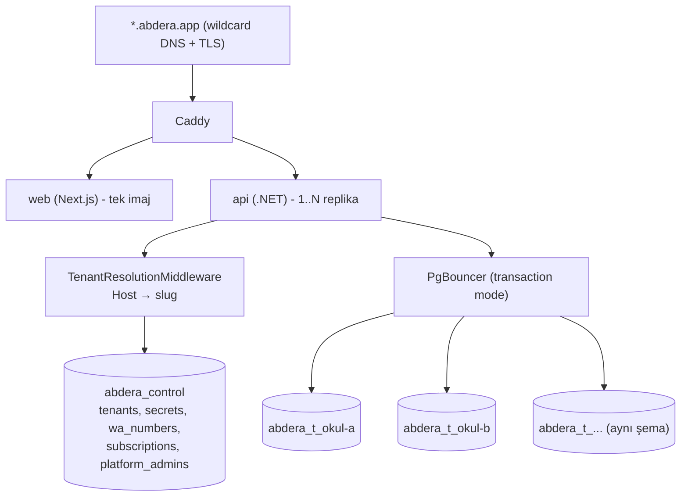

# Abdera — Çok kiracılı (multi-tenant) SaaS mimarisi

> **Durum: YALNIZCA MİMARİ TASLAK — GELİŞTİRİLMEYECEK, `main`'e MERGE EDİLMEYECEK.**
> Bu belge `arch/multi-tenant` branch'inde tutulur. Kodda hiçbir değişiklik yapılmadı.
> `CLAUDE.md`, `docs/10-decisions.md` ve canlı sistem bu belgeden etkilenmez.
> Uygulamaya geçmek, kullanıcının ayrıca ve açıkça onay vermesini gerektirir.
>
> Hazırlanma tarihi: 2026-10-15 · Taban commit: `938e0bc` (sürüm 2026.10.15.3)

## 1. Soru ve bağlam

> "abderayı 100 şirkete satmak istesem, multi tenant bir yapı kurmak istesem neler yapmam gerekiyor ... sqlite mı kullansak daha verimli olur ya da mevcut veritabanını müşteri bazında çoklayabilir miyim"

Bugün Abdera **tek okul = tek kurulum**: bir Hetzner sunucusunda `db + api + web + caddy` (docker compose), tek `AbderaDbContext` (64 DbSet), tek domain; okula ait ayarlar (WhatsApp, banka, SMTP, sessiz saat, saat dilimi) `.env`'den okunuyor.

Kod tabanında kararı belirleyen bulgular:

| Bulgu | Nerede |
|---|---|
| `FOR UPDATE SKIP LOCKED` | `Modules/Messaging/Infrastructure/NotificationDispatcher.cs`, `Modules/Billing/Infrastructure/OverdueReceivableSweeper.cs` |
| `xmin` optimistic concurrency (17 yer) | çeşitli `Persistence/*Configuration.cs` |
| `jsonb` audit kolonları, kısmi unique index (`tuition_rates`), `timestamptz` | migration'lar |
| `pg_dump` + AES-256-GCM yedek | `Modules/Ops/Infrastructure/BackupService.cs` |
| Tek satırlık ayar tabloları | `BillingSettings`, `NotificationAutomationSettings`, `SystemHealthStatus` |
| Global unique'ler (31 adet) | `users.email`, `guardians.phone_number`, `iban`, `skill_definitions.code` … |
| Ham SQL ile 15 tablo temizliği | `Modules/People/Infrastructure/PersonEraser.cs` |
| 7 arka plan işçisi tek DB varsayıyor | `MonthlyReceivableGenerator`, `OverdueReceivableSweeper`, `NotificationDispatcher`, `AttendanceReminderWorker`, `LessonNoteReminderWorker`, `BackupService`, `SystemHealthMonitor` |
| Saat dilimi **singleton** | `Shared/IClock.cs` → `SystemClock(SCHOOL_TIMEZONE)` |
| Sağlayıcı seçimi `Build()`'den önce, singleton | `Program.cs` WhatsApp/Banka/Yedek/E-posta blokları |
| Bağlantı dizesi zaten deferred | `Program.cs` → `AddDbContext((sp, o) => o.UseNpgsql(ResolveConnectionString(sp)))` |

## 2. Karar 1 — SQLite: hayır, PostgreSQL kalır

| | SQLite (okul başına dosya) | PostgreSQL |
|---|---|---|
| `SKIP LOCKED`, `xmin`, `jsonb`, kısmi index, `timestamptz` | yok / farklı semantik → dispatcher ve concurrency yeniden yazılır | var, kod olduğu gibi çalışır |
| Eşzamanlı yazma | tek yazar kilidi; işçiler + öğretmenler + webhook sıraya girer | MVCC |
| Yatay ölçek (2. api replikası) | dosya paylaşılamaz | sorun yok |
| Migration | Npgsql'e göre üretilmiş set + ikinci provider seti | tek set |
| Yedek | dosya kopyası | `pg_dump` zaten var |

SQLite'ın tek gerçek avantajı "her okul ayrı dosya" izolasyonu; bu, PostgreSQL'de **okul başına ayrı database** ile kod değiştirmeden elde edilir. Ölçek (okul başına ~150 öğrenci, 100 okulda ~15.000 öğrenci) tek bir 8 çekirdekli Postgres için küçüktür.

## 3. Karar 2 — İzolasyon modeli: okul başına database

| Seçenek | Değerlendirme |
|---|---|
| Paylaşılan şema + `tenant_id` (+ EF global filter / RLS) | **Reddedildi.** 64 tablo, 31 unique index, ham SQL, tek-satır ayar tabloları ve `PersonEraser` değişir. Tek unutulan filtre = okullar arası çocuk verisi sızıntısı (KVKK). |
| Müşteri başına ayrı compose kurulumu | **Reddedildi** (genel model olarak). 100 sunucu/deploy/sertifika/izleme. Kendi sunucusunu isteyen kurumsal müşteri için seçenek olarak kalır; imaj tek kiracılı modda çalışmaya devam eder. |
| **Okul başına database, tek Postgres kümesi, tek api/web** | **Önerilen.** Her kiracı `abdera_t_<slug>` database'ine sahip, şema bugünküyle birebir. Domain kodu ve kısıtlar değişmez; değişen yalnızca "hangi database'e bağlanıyorum" katmanı. Kiracı silme/geri yükleme/dışa aktarma = tek `DROP` / `pg_restore` / `pg_dump`. Bir okulun bozuk migration'ı diğerlerini etkilemez. |

## 4. Hedef mimari

### 4.1 Control plane
Ayrı `abdera_control` database'i + `ControlPlaneDbContext`. ("Tek `AbderaDbContext`" kuralı kiracı verisi için geçerli kalır; control plane kiracı verisi değildir.)

- `tenants(id uuid, slug unique, display_name, status [Provisioning|Active|Suspended|MigrationFailed|Deleted], db_name, time_zone, created_at, updated_at)`
- `tenant_secrets(tenant_id, key, ciphertext)` — WhatsApp token/phone_number_id, banka anahtarı, `PayloadSigningKey`; Data Protection ile şifreli.
- `tenant_whatsapp_numbers(phone_number_id unique → tenant_id)` — webhook yönlendirmesi.
- `subscriptions`, `plans` — ilk aşamada elle yönetim (online ödeme `CLAUDE.md` yasak listesinde).
- `platform_admins` — platform sahibi hesabı, okul admin'lerinden ayrı.

### 4.2 Kiracı çözümleme
- `Shared/Tenancy/TenantContext` (scoped): `TenantId`, `Slug`, `ConnectionString`, `TimeZone`.
- `TenantResolutionMiddleware`: `Host` → subdomain → kiracı (60 sn in-memory önbellek). Bilinmeyen → 404, askıda → 423. Muaf: `/health`, `/api/platform/*`, `/api/webhooks/*` (webhook'lar kiracıyı gövdeden çözer).
- `AddDbContext((sp, o) => o.UseNpgsql(sp.GetRequiredService<TenantContext>().ConnectionString))` — `ResolveConnectionString` şablonu üretir, `Database` kiracıdan gelir.
- **Tek kiracılı mod (varsayılan):** `Tenancy:Mode` ayarlanmamışsa `TenantContext` mevcut `ConnectionStrings:Default`'u döner; bugünkü kurulum ve testler davranış değiştirmeden çalışır.
- Middleware, `/api` için bağlantıyı açık tutan mevcut ara katmandan **önce** çalışmalı.

### 4.3 Oturum güvenliği
- Çerez `Domain` ayarlanmaz (host-only): `a.abdera.app` oturumu `b.abdera.app`'e gönderilmez.
- Ek savunma: oturuma `tenant_id` claim'i; mevcut `OnValidatePrincipal` (SecurityStamp kontrolü) içinde istek kiracısıyla karşılaştırılır, uyuşmazsa `RejectPrincipal`.
- Data Protection anahtarları paylaşılabilir (tek uygulama), ama `SetApplicationName` aynı kalır; kiracı ayrımı claim + host-only çerezle sağlanır.

### 4.4 Singleton → kiracıya bağlı hale gelecekler
| Bugün | Hedef |
|---|---|
| `SystemClock.SchoolTimeZone` (singleton, `SCHOOL_TIMEZONE`) | `IClock` scoped, saat dilimi `TenantContext.TimeZone`'dan |
| `CloudApiWhatsAppClient` sırları (`WhatsApp:*` config) | sırlar `tenant_secrets`'tan, istemci scoped; uygulama sırrı (`AppSecret`, imza doğrulama) platform genelinde tek |
| `IBankPaymentProvider` | kiracı sırrıyla; gerçek sağlayıcı seçilmediği için ertelenebilir |
| `IEmailSender`, AI üreticileri | platform genelinde tek hesap kalır, gönderen adı kiracıdan |

### 4.5 Arka plan işçileri
Ortak `TenantJobRunner`: aktif kiracıları control plane'den okur; her kiracı için yeni DI scope açar, `TenantContext`'i set eder, işçinin mevcut tek-tur gövdesini çağırır. İş gövdeleri değişmez, döngü dışa alınır.
- Bir kiracının hatası diğerlerini durdurmaz; `JobHeartbeat` kiracı bazında.
- Çoklu replikada `SKIP LOCKED` zaten çift işlemeyi önler; aylık aidat üretimi gibi tekil işler için `pg_try_advisory_xact_lock`.

### 4.6 Entegrasyonlar
- **WhatsApp:** Meta Tech Provider + Embedded Signup; her okul kendi numarasını bağlar. Tek webhook URL'i; `phone_number_id` → `tenant_whatsapp_numbers` → kiracı. Bilinmeyen numara reddedilir. `FakeWhatsAppClient` aynen kalır.
- **Banka (sanal IBAN):** tek webhook; IBAN → kiracı eşlemesi control plane'de. Gerçek sağlayıcı seçilene kadar ertelenir.

### 4.7 Provisioning ve migration
- `POST /api/platform/tenants` (platform admin): `CREATE DATABASE abdera_t_<slug>` → `DatabaseMigrator` o DB'ye → `AdminBootstrapper` okulun ilk admin'i → `Active`.
- Deploy: `DatabaseMigrator` tüm kiracılarda (paralellik ~4) koşar; başarısız kiracı `MigrationFailed` olur ve trafiğe kapanır, diğerleri devam eder. `abdera-deploy` akışı buna göre güncellenir.
- Seed verisi (`skill_definitions`, enstrüman, kütüphane kataloğu) migration ile her kiracıya basılır.
- `AbderaDbContextFactory` (design-time) değişmez.

### 4.8 Yedek ve kiracı kapatma
- `BackupService`: kiracı başına `pg_dump` (mevcut şifreleme + SFTP), dosya adında slug. Kiracı başına geri yükleme.
- Kapatma: `Suspended` → 30 gün → son yedek → `DROP DATABASE`. `audit_log` kuralı kiracı içinde aynen geçerli.

### 4.9 Kapasite
- Bugün `Maximum Pool Size=150`, `max_connections=250` tek DB için ayarlı (`LOADTEST.md`). 100 DB × Npgsql havuzu bu sınırı aşar.
- Çözüm: **PgBouncer (transaction mode)**, uygulamada kiracı başına `Maximum Pool Size≈10`. `SKIP LOCKED` ve `xmin` transaction mode ile uyumlu; session-level advisory lock kullanılmaz.
- Başlangıç: tek Hetzner makinesi (8 vCPU / 32 GB) 100 küçük okulu taşır. Büyüyünce Postgres ayrı makineye, api 2 replika.
- PgBouncer yeni bir bağımlılıktır — uygulamaya geçilirse `docs/10-decisions.md`'ye karar olarak yazılır.

### 4.10 Frontend
- `NEXT_PUBLIC_API_BASE_URL` göreli (`/api`) → aynı imaj her subdomain'de çalışır (Caddy zaten tek origin sunuyor).
- Okul adı/logosu `GET /api/tenant/branding`'den.
- `platform.abdera.app`: kiracı listesi, oluşturma, askıya alma, kullanım.
- Kök domainde "okul adresiniz" → `slug.abdera.app` yönlendirmesi.
- `Caddyfile`: wildcard site + DNS-01 challenge ile wildcard sertifika.

## 5. Ürünleştirme (kod dışı ama satış için şart)

Okula özel sabitler kiracı ayarına taşınmadan ikinci okula satış kodu çatallar. Her biri için "hesabın tek yeri" kuralı korunur, yalnızca sabit ayardan okunur:

| Sabit | Yer |
|---|---|
| Grup dersi öğretmen payı %40 | `Modules/Billing/Domain/GroupLessonPay.cs` (`SharePercent`) |
| Ödeme haftası Pzt→Cmt, cumartesi ödeme | `TeacherPayWeek` |
| Haftalık en fazla 4 ders | `Modules/Scheduling/Domain/StudentWeeklyLessonPolicy.cs` |
| Telafi: ≥24 saat iptal, mazeretli 21 gün | `MakeupCredit`, `ExcusedMakeupCredit` |
| Çoklu kurs / kardeş indirimi, vade günü | `BillingSettings` (zaten ayar tablosu) |
| Okul saat dilimi | `SCHOOL_TIMEZONE` |

Diğer: KVKK (okul veri sorumlusu, Abdera veri işleyen → DPA sözleşmesi, VERBİS), destek için "okul olarak gir" (impersonation, `audit_log`'a yazılı), abonelik takibi.

## 6. Fazlar (her biri ayrı onay gerektirir)

| Faz | İçerik | Çıktı |
|---|---|---|
| T0 | Karar kaydı, sabit envanteri | Bu belge |
| T1 | `TenantContext` + middleware + control-plane DB; tek kiracılı mod varsayılan, mevcut okul tek kiracı | Davranış değişmez |
| T2 | `TenantJobRunner`, 7 işçi kiracı döngüsünde; `IClock` kiracıya bağlı | İşçiler N kiracıda |
| T3 | Provisioning API, çoklu kiracı migration, kiracı başına yedek, platform ekranı | 2. okul açılabilir |
| T4 | WhatsApp kiracı sırları + webhook yönlendirme, `tenant_id` claim, PgBouncer | Pilot 3–5 okul |
| T5 | Bölüm 5 ayarları, branding, impersonation, abonelik | Satışa hazır |

## 7. Doğrulama stratejisi

- **Sızıntı testi (en önemli):** `WebApplicationFactory` + Testcontainers, iki kiracı DB'si. A'nın çereziyle `b.` host'una istek → 401; A'da oluşturulan öğrenci B'de görünmez; her işçi iki kiracıda koşup yalnızca kendi DB'sine yazar.
- Webhook: `phone_number_id` doğru kiracıya düşer, bilinmeyen numara reddedilir.
- Migration: bir kiracıda bilerek kırık migration → diğerleri `Active` kalır.
- Mevcut test paketi tek kiracılı modda aynen geçer (regresyon yok).
- Yük: `loadtest/` senaryosu 20 kiracı × mevcut profil, PgBouncer arkasında p95 < 500 ms.

## 8. Uygulamaya geçilirse dokunulacak dosyalar

- `backend/src/Abdera.Api/Program.cs` — DbContext kaydı, cookie `OnValidatePrincipal`, sağlayıcı kayıtları, middleware sırası
- `backend/src/Abdera.Api/Shared/` — `IClock.cs`, `DatabaseMigrator.cs`, `AdminBootstrapper.cs`, yeni `Tenancy/`
- 7 işçi (bölüm 1 tablosu), `CloudApiWhatsAppClient.cs` + webhook feature'ı
- `docker-compose.yml`, `Caddyfile`, `deploy/hetzner/*`
- `backend/tests/Abdera.Tests/Integration/AbderaWebApplicationFactory.cs` — iki kiracılı varyant
- Yeni: `ControlPlane/` (context, migration'lar, platform endpoint'leri)
